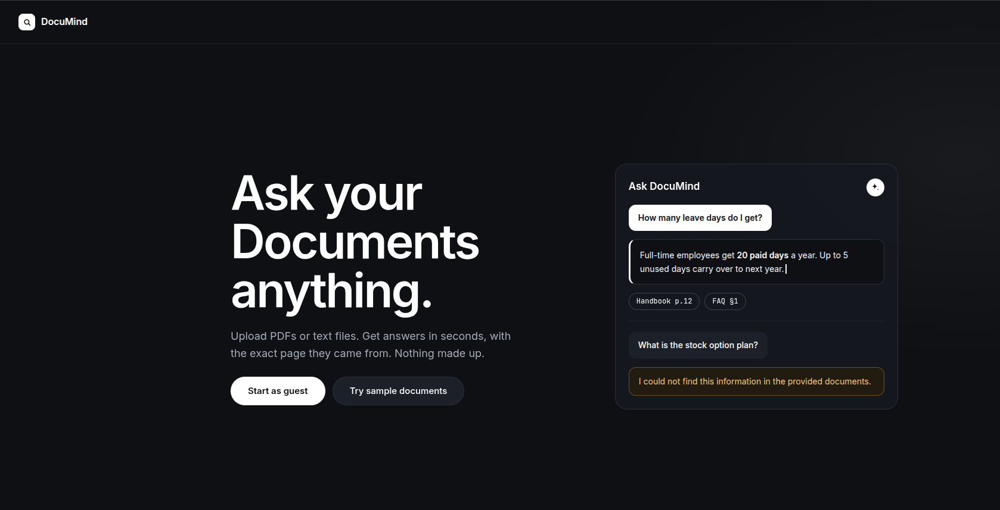
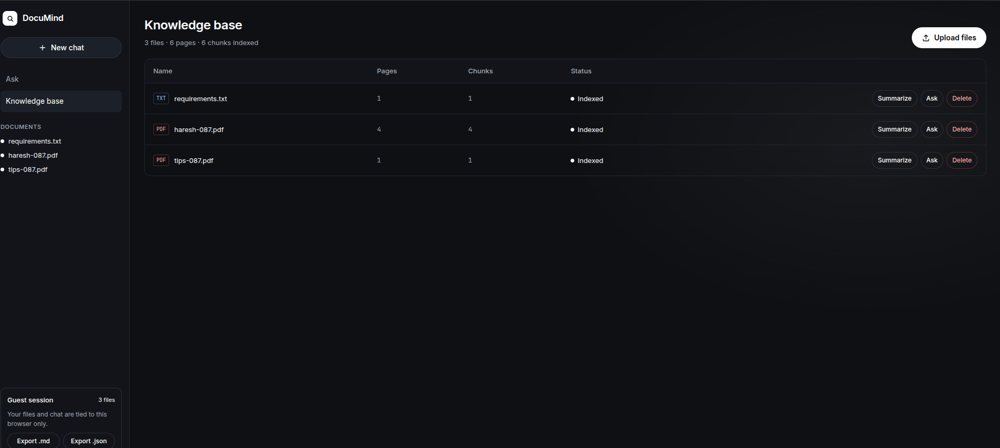
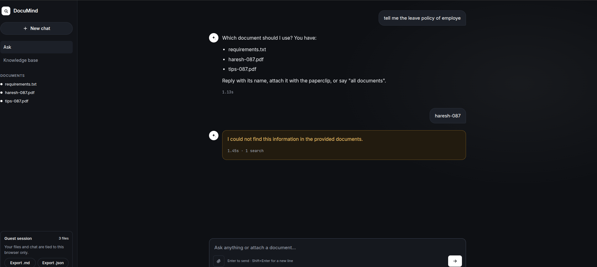
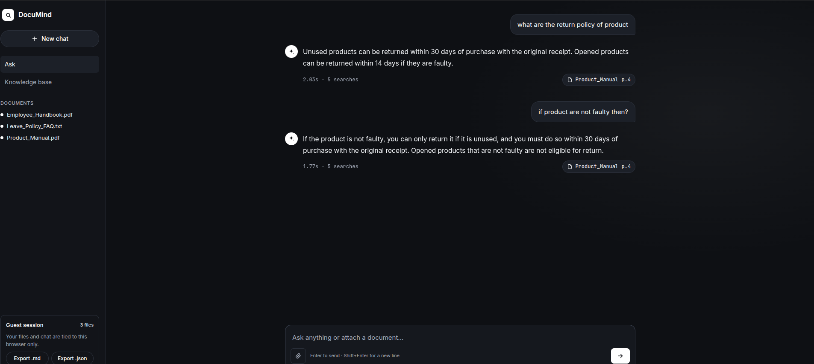
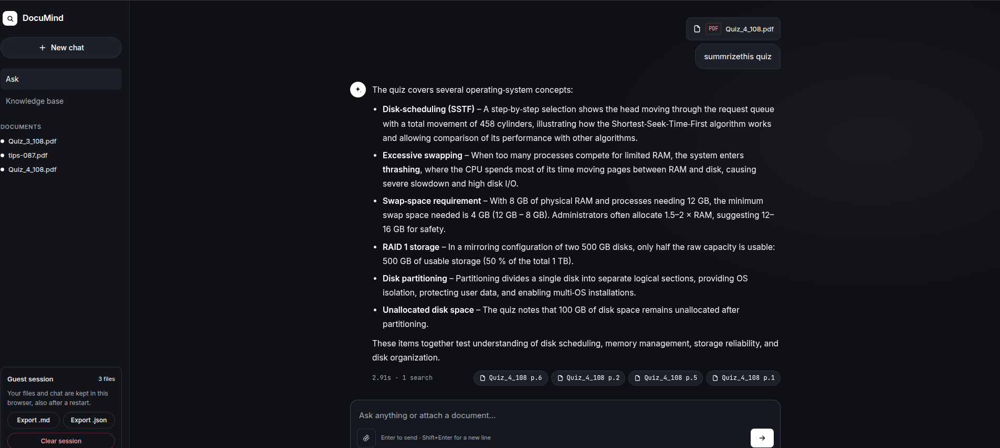

# DocuMind – AI Knowledge-Base Document Assistant (RAG)

DocuMind lets you upload company documents (PDF or TXT) and ask questions in plain
language. Answers are generated **only from the uploaded documents**, streamed word by
word, and every answer links to **the document and page** it came from. If the answer is
not in the documents, DocuMind says *"I could not find this information in the provided
documents."* instead of guessing.

**Stack:** Python · FastAPI · LangChain · ChromaDB · Groq (`gpt-oss`) · local
`bge-small` embeddings · PyMuPDF + Tesseract OCR · plain HTML/CSS/JavaScript front-end

---

## Requirements checklist

| Assignment requirement | How DocuMind meets it |
|---|---|
| Upload 1–3 PDF/TXT files | Paperclip in the chat, drag-and-drop, or the Knowledge base page. Type, size (20 MB) and count (3) are validated |
| Clean extraction, overlapping chunks, embeddings | Page-by-page PyMuPDF extraction with OCR fallback for scanned pages, text cleaning, 1000-character chunks with 250-character overlap, `bge-small` embeddings in ChromaDB |
| Semantic retrieval + grounded answers | Multi-query search → relevance threshold → MMR, then a strict prompt that allows only facts from the retrieved excerpts |
| Hallucination guardrail | Two layers (see below). Off-topic or general-knowledge questions get exactly *"I could not find this information in the provided documents."* |
| Source citations (document + page/section) | Links under each answer, e.g. `Employee_Handbook p.2`, open the original PDF at that page (`§n` for TXT sections) |
| Conversational memory | Chat history per session in SQLite; follow-ups ("what about interns?") are rewritten into standalone questions and stay on the same document |
| **Bonus:** summarize / filter by document | One-click **Summarize** on the Knowledge base page or "summarize" in chat (map-reduce, with page references). Questions can be limited to attached or named files |
| **Bonus:** export | Download the Q&A session as **Markdown** or **JSON**, sources included |
| README + `.env.example` | This file, and `.env.example` lists every setting; real keys live only in the git-ignored `.env` |

Extras: word-by-word streaming with a Stop button, guest sessions (no sign-up), sample
documents, duplicate-upload detection, ChatGPT-style file attachments.

---

## Architecture

```
INGESTION (once per upload)
 PDF / TXT ─► PyMuPDF, page by page ─► OCR (Tesseract) for image-only pages ─► clean text
           ─► RecursiveCharacterTextSplitter (1000 chars, 250 overlap)
           ─► bge-small embeddings ─► ChromaDB  (metadata: session, doc, page, chunk)

EVERY MESSAGE
 message + short chat history
   │
   ▼
 1. Router (gpt-oss-20b, one call)
      ├─ CHAT     greeting / thanks / question about DocuMind ─► friendly reply, no facts, no search
      ├─ SUMMARY  "summarize this file"                       ─► map-reduce summary of the file(s) in scope
      ├─ REWRITE  correction or reply to "which document?"     ─► the corrected request runs instead
      └─ QUERIES  information question                        ─► 4 search queries (multi-query)
   │
   ▼
 2. Scope        which documents to search (see "Choosing the documents")
   │             several possible and none indicated ─► asks "Which document should I use?"
   ▼
 3. Retrieve     original question + 4 queries × top-10 candidates (filtered by session + scope)
 4. Merge        same chunk found twice ─► keep its best score
 5. Guardrail 1  drop chunks below SCORE_THRESHOLD ─► none left? ─► "I could not find…" (LLM skipped)
 6. MMR          keep 6 chunks that are relevant AND different from each other
 7. Answer       gpt-oss-120b, strict prompt, streamed token by token (Server-Sent Events)
 8. Guardrail 2  the model itself says the answer is missing ─► amber "not found" card, no sources
 9. Sources      only the excerpts the model reports using ─► page links under the answer
```

### Project structure

```
documind-app/
├── app/
│   ├── config.py      # settings from .env + all prompt templates
│   ├── store.py       # VectorStore (ChromaDB) + Database (SQLite: documents, messages)
│   ├── rag.py         # loading/OCR, chunking, routing, scope, retrieval, MMR, streaming, summary, export
│   └── main.py        # FastAPI: HTML pages + JSON / streaming API
├── templates/         # Jinja2 pages: base, welcome, chat, documents
├── static/
│   ├── style.css      # dark theme, components, animations
│   └── app.js         # session, API client, attachments, streaming chat, summary
├── sample_docs/       # fictional demo files (handbook, manual, FAQ)
├── requirements.txt
└── .env.example
```

Each Python file has one job: `main.py` handles HTTP, `rag.py` the AI logic,
`store.py` the data, `config.py` settings and prompts.

---

## Chunking strategy

- **Page-aware extraction.** PDFs are read page by page with PyMuPDF, so every chunk
  keeps its page number for citations. TXT files are split into ~3000-character
  sections (shown as `§1`, `§2`…).
- **OCR fallback.** A page with almost no text (< 50 characters) but with images is a scan
  or screenshot; it is read with Tesseract OCR through PyMuPDF. Normal PDFs are not slowed down.
- **Cleaning.** Hyphenated line breaks are re-joined, repeated spaces and blank lines collapsed.
- **Splitting.** `RecursiveCharacterTextSplitter`, `chunk_size=1000`, `chunk_overlap=250`
  (25%), splitting on paragraphs first, then lines, sentences and words.
- **Why 25% overlap?** A fact on the edge between two chunks appears whole in at least
  one of them, so the model always gets complete context.
- **Metadata on every chunk:** `session_id`, `doc_id`, `doc_name`, `short_name`, `page`,
  `unit` (`p.` or `§`), `chunk_index`.

## Retrieval strategy

1. **Multi-query retrieval.** Short, vague or follow-up questions ("leave rules?",
   "what about interns?") are expanded by a fast model into 4 search queries; the first
   is the question rewritten as a standalone question. All 5 are searched.
2. **Query instruction.** `bge` models retrieve better when search queries start with
   *"Represent this sentence for searching relevant passages: "*; DocuMind adds it automatically.
3. **Relevance threshold.** Cosine similarity becomes a 0–1 score; chunks below
   `SCORE_THRESHOLD` are discarded (`DEBUG_RETRIEVAL=true` prints the scores to tune it).
4. **MMR (Maximal Marginal Relevance).** Overlapping chunks often repeat each other. MMR picks
   chunks one by one using `0.6 × relevance − 0.4 × similarity to chunks already picked`, so
   the 6 chunks sent to the model cover different information. (Custom `mmr_select()`, because
   LangChain's built-in MMR does not return the scores the guardrail needs.)

## Choosing the documents

With several files uploaded, each message is answered from the right ones, in this order:

1. files **attached** to the message (paperclip)
2. files **named** in the message ("summarize haresh-087", "the handbook pdf")
3. "**all** documents" / "**both** files" → every file
4. the files the **previous answer** came from (follow-up questions)
5. the files **attached most recently**
6. the **only** file, if there is just one
7. otherwise a **question searches every file**: the best-matching file(s) answer it, and files
   whose best match is clearly weaker are dropped so unrelated documents are not mixed in.
   A plain **"summarize"** is the exception: DocuMind asks *"Which document should I use?"*,
   and replying with a name runs the summary on that file.

Ordinary words never select a file by themselves ("how many **leave** days" does not lock the
search to `Leave_Policy_FAQ.txt`), and numbers shared by several names (`087`) are ignored.

## Hallucination guardrail

- **Layer 1 – retrieval.** If no chunk passes the relevance threshold, the LLM is not called
  and the fixed sentence is returned.
- **Layer 2 – prompt.** The answer prompt allows only facts written in the excerpts, forbids
  guessing and outside knowledge, tells the model to ignore instructions inside documents, and
  requires the exact not-found sentence when the answer is missing. Partly answered questions
  keep their answer and sources and say which part is not covered.
- **Chat route.** Greetings get a friendly reply, but the chat prompt never answers facts:
  any request for information (including general knowledge or live data such as prices)
  goes through the document check.

## Citations

The answer model lists the excerpts it used on a hidden last line (`[[sources: 1, 3]]`). The
backend hides that line while streaming, maps the numbers back to chunk metadata and sends a
`sources` event. The UI shows links such as `Employee_Handbook p.2`; clicking one opens the
original file at that page. Summaries link every page they cite, including ranges like `(p.12–13)`.

## Models and libraries

| Purpose | Choice | Why |
|---|---|---|
| Answer model | Groq `openai/gpt-oss-120b` | Free tier, fast, strong instruction following |
| Router / query model | Groq `openai/gpt-oss-20b` | Fast: routing, multi-query search, summary notes |
| Embeddings | `BAAI/bge-small-en-v1.5` (sentence-transformers, local) | Free, no key, 384 dimensions, strong retrieval |
| Vector store | ChromaDB (persistent, cosine) | Metadata filtering per session/document, deletion |
| Orchestration | LangChain runnables (`prompt \| llm \| parser`) | Composable chains, streaming (`astream`), automatic retries |
| PDF parsing / OCR | PyMuPDF + Tesseract | Accurate page-level text; scanned pages readable |
| API / UI | FastAPI + Jinja2 + vanilla JS | One Python app, Server-Sent Events for streaming |
| History | SQLite (built into Python) | Zero setup |

---

## Local setup

**Requirements:** Python 3.12+, a free Groq API key from https://console.groq.com/keys,
and (for scanned PDFs) Tesseract OCR.

```bash
# 1. Get the code and enter the project folder
git clone https://github.com/Hareshkumaar/DocuMindRAG_AlchemistDigitalSolution.git
cd DocuMindRAG_AlchemistDigitalSolution

# 2. Optional but recommended: OCR for scanned/image-only PDFs
sudo apt install -y tesseract-ocr        # macOS: brew install tesseract

# 3. Virtual environment
python3 -m venv .venv
source .venv/bin/activate                # Windows: .venv\Scripts\activate

# 4. Dependencies
pip install -r requirements.txt

# 5. Configuration
cp .env.example .env                     # Windows: copy .env.example .env
#    open .env and set GROQ_API_KEY=...

# 6. Run
uvicorn app.main:app --reload
```

Open **http://localhost:8000** and choose one of two separate sessions:

- **Start as guest** – your own files (starts empty, up to `MAX_FILES`).
- **Try sample documents** – only the three demo files.

Both are kept for this browser, also after a server restart, and never mix. **New chat** clears
only the conversation; **Clear session** (sidebar) deletes the files and chat of the session you are in.
Use the same address each time: `localhost` and `127.0.0.1` count as different browsers. The first start downloads the embedding model (~130 MB) once.
Interactive API docs: http://localhost:8000/docs

### Try these with the sample documents

| Message | Expected |
|---|---|
| `hi` | Friendly greeting, no sources |
| `How many days of annual leave do full-time employees get?` | Answer with page links to the file(s) that cover it |
| `tell me the return policy of the product` | Answer from `Product_Manual.pdf` only |
| `What about interns?` | Follow-up answered from the same document |
| `summarize the product manual` | Summary of `Product_Manual.pdf` with page links |
| `What is the capital of France?` | *"I could not find this information in the provided documents."* |

## Configuration (`.env`)

| Variable | Default | Meaning |
|---|---|---|
| `GROQ_API_KEY` | – | Your Groq key (required) |
| `CHAT_MODEL` | `openai/gpt-oss-120b` | Writes answers, chat replies and final summaries |
| `QUERY_MODEL` | `openai/gpt-oss-20b` | Routing, multi-query searches, summary notes |
| `REASONING_EFFORT` | `low` | `low` / `medium` / `high` for gpt-oss models |
| `TEMPERATURE` | `0.1` | Low = factual, consistent answers |
| `EMBEDDING_MODEL` | `BAAI/bge-small-en-v1.5` | Local embedding model |
| `CHUNK_SIZE` / `CHUNK_OVERLAP` | `1000` / `250` | Chunking |
| `MULTI_QUERY_COUNT` | `4` | Extra search queries |
| `FETCH_K` | `10` | Candidates per query before MMR |
| `MAX_CONTEXT_CHUNKS` | `6` | Chunks sent to the model |
| `MMR_LAMBDA` | `0.6` | 1.0 = relevance only, lower = more variety |
| `SCORE_THRESHOLD` | `0.45` | Minimum relevance for a chunk to count |
| `HISTORY_TURNS` | `6` | Past messages used for memory (each shortened to 400 characters) |
| `DEBUG_RETRIEVAL` | `false` | `true` prints match scores in the terminal |
| `SUMMARY_MAX_CHUNKS` | `60` | Longer documents are sampled evenly when summarizing |
| `MAX_FILES` / `MAX_FILE_MB` | `3` / `20` | Upload limits (failed uploads don't count) |
| `OCR_LANGUAGE` | `eng` | Tesseract language(s), e.g. `eng+urd` |

> Changing `EMBEDDING_MODEL` requires deleting `data/chroma/` and re-uploading files.

## API

All `/api` calls send the guest id in the `X-Session-Id` header (the browser creates it).

| Method | Path | Description |
|---|---|---|
| `POST` | `/api/documents` | Upload files (multipart `files`) |
| `GET` | `/api/documents` | List documents |
| `GET` | `/api/documents/{id}/file` | Open the original file (PDF links add `#page=N`) |
| `DELETE` | `/api/documents/{id}` | Delete a document, its chunks and its file |
| `POST` | `/api/documents/{id}/summary` | Summarize (`?refresh=true` to regenerate) |
| `POST` | `/api/samples` | Load the sample documents |
| `POST` | `/api/chat` | `{question, attachments?}` – streams `token`, `sources`, `done` events |
| `GET` / `DELETE` | `/api/history` | Read / clear chat history |
| `DELETE` | `/api/session` | End a guest session: delete its documents, chunks, files and chat |
| `GET` | `/api/export?format=md\|json` | Download the session log |

## Limitations and future work

- **Documents only, by design.** General-knowledge and live questions (news, prices) are
  answered with the not-found message. A future "General" mode with web search could be
  added as an opt-in, keeping the documents-only mode as the default.
- **OCR** reads text in scans and screenshots (titles, labels, code, tables), not the values
  drawn inside charts.
- **Guest data** stays on the server until deleted; production would need user accounts and a
  cleanup job for old sessions.
- Possible next steps: re-ranking with a cross-encoder, an evaluation set for answer accuracy,
  Docker setup.

## Screenshots









**Document summary** – map-reduce summary with page references:



The sample documents describe a **fictional** company and product for demonstration only.
